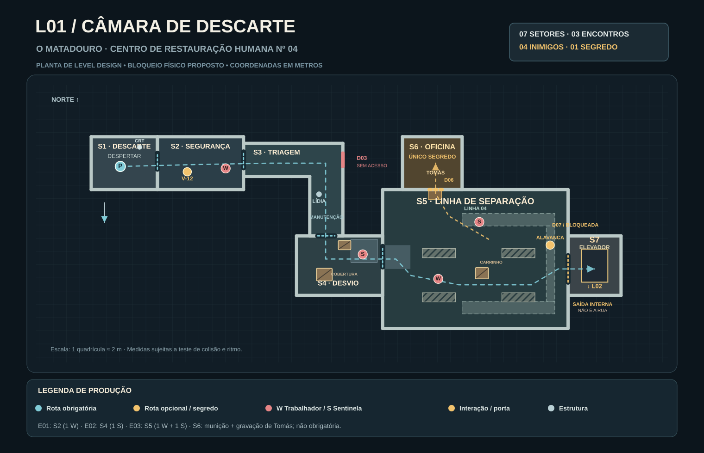

# LVL-001-MAP — Planta baixa da Câmara de Descarte

**Status:** blockout proposto para implementação e playtest, não geometria já executada.  
**Fase:** [L01 — Câmara de Descarte](l01-discard-chamber.md), em [O Matadouro](../locations/slaughterhouse.md).  
**Artefatos:** [planta vetorial SVG](l01-floor-plan.svg) · [layout estruturado JSON](l01-layout.json).

## Visão geral

A planta transforma a sequência canônica S1 → S2 → S3 → S4 → S5 → S7 em um percurso top-down construível, com **exatamente um segredo opcional**, S6. Todos os setores permanecem dentro do Matadouro. O elevador S7 **desce internamente** para a Ala dos Retornados, L02. O bloqueio D03 é uma porta falsa de continuação da triagem, fechada durante toda L01; a rota legível é a manutenção.

A planta usa **metros fictícios de blockout**, origem no canto sudoeste (X para leste, Y para norte, Z para cima). Desenho e medidas **não são arquitetura final**, nem o arquivo JSON é uma implementação do motor. Paredes de espessura, altura de personagem, colisões, subida/descida de rampas, field of view e distâncias da V-12 precisam ser ajustados no protótipo.

## Planta

## Setores e dimensões propostas

| Setor | Região no layout (m) | Papel espacial | Encontro |
| --- | --- | --- | --- |
| S1 — Câmara de Descarte | X 3–13 · Y 26–34 (10 × 8) | Acordar próximo da maca, olhar terminal CRT e passar pela D01 | Nenhum |
| S2 — Posto de Segurança | X 13–26 · Y 26–34 (13 × 8) | Corpo do segurança, V-12 incontornável, primeiro Worker | E01: 1 Worker |
| S3 — Corredor de Triagem | Polígono em L, X 26–41 · Y 19–33 | Porta vermelha D03 fechada, desvio em direção ao sul, gravação de Lídia | Nenhum |
| S4 — Desvio de Manutenção | X 34–47 · Y 10–19 (13 × 9) | Duas coberturas, primeiro ataque à distância, janela/visor de inspeção | E02: 1 Sentinel |
| S5 — Linha de Separação | X 47–75 · Y 5–26 (28 × 21) | Arena circular com quatro esteiras, carrinho, duas passarelas, alavanca, acesso secreto e elevador | E03: 1 Worker + 1 Sentinel |
| S6 — Oficina Clandestina | X 50–59 · Y 26–34 (9 × 8) | **Único segredo**: gravação antiga de Tomás Neri + cartuchos | Nenhum |
| S7 — Elevador de Serviço | X 75–83 · Y 10–19 (8 × 9) | Plataforma e botão de encerramento, transição **interna** para L02 | Nenhum |

## Conexões e portas

| ID | Posição física proposta | Ligação | Regra |
| --- | --- | --- | --- |
| D01 | X 13, Y 29,1–31,5 | S1 ↔ S2 | Abre após evento do terminal; sem depender da foto |
| D02 | X 26, Y 29,3–31,7 | S2 ↔ S3 | Acesso normal |
| D03 | X 41, Y 29,5–31,5 | Ala de processamento fora do mapa | **Permanentemente bloqueada**; alarme e placa de manutenção orientam ao sul |
| D04 | Y 19, X 37,2–39,8 | S3 ↔ S4 | Desvio manual sinalizado |
| D05 | X 47, Y 14,3–17,4 | S4 ↔ S5 | Acesso aberto, entrada visual ampla da arena |
| D06 | Y 26, X 54–56 | S5 ↔ S6 | **Única passagem secreta**, oculta atrás de armário móvel |
| D07 | X 75, Y 12–16 | S5 ↔ S7 | Porta hidráulica aberta ao acionar a alavanca em S5 |

**Caminho obrigatório:** S1 → S2 → S3 → S4 → S5 → S7.  
**Laço opcional:** S5 → S6 → S5. Não há mais caminhos ocultos, chaves ou salas secretas em L01.

## Layout de combate e leitura

**E01 — S2.** V-12 perto do corpo, visível antes do Worker. Inimigo posicionado adiante (X 23,3; Y 29,2). A arma fica no percurso natural, com espaço de recuo em S2. A D02 não cria armadilha e a colisão do cadáver não bloqueia a passagem.

**E02 — S4.** Sentinel na plataforma de inspeção (X 44; Y 16,2; Z 1,1); coberturas em X 37–39,4/Y 12,2–14,1 e X 40,3–42,2/Y 16,9–18,3. Jogador ouve aviso e vê mira antes do disparo; a altura precisa permitir mira confortável. A visão superior do conjunto de manutenção é narrativa, não uma sala extra.

**E03 — S5.** Entrada pela parede oeste (D05), com rampa curta a validar. Worker próximo ao piso (X 55,4; Y 12,5) e Sentinel na passarela norte (X 61,6; Y 21,1; Z 1,4). A arena contém quatro esteiras retangulares, carrinho central e duas passarelas. Não bloquear corredores de circulação com props pequenos. As passarelas de fundo são cenário, exceto pontos explicitamente utilizáveis pela IA. A alavanca está perto de D07 (X 72,3; Y 17,6), visível desde a entrada por composição e iluminação; o uso não depende de eliminar os inimigos.

**Economia:** quatro inimigos em três encontros, no máximo dois simultaneamente no escopo proposto. E04 continua desativado. Munição de reforço está em S2 e a oficina guarda bônus opcional; não depender do segredo para vencer.

## Segredo único — S6 Oficina Clandestina

- **Sinal honesto:** armário enferrujado na parede norte da arena (próximo de X 55; Y 25), com círculo vazio e três riscos de giz. Atrás dele há uma fresta de luz âmbar. A marca é discreta, mas visível de perto sem procurar um pixel.
- **Descoberta:** interagir com o armário desloca a peça e expõe D06, sem exigir tiros em paredes aleatórias nem acionar a alavanca principal.
- **Interior:** bancada com ferramentas organizadas à mão, uma caixa de cartuchos, lanterna amarela e gravador marcado “PREGO”, contendo a mensagem preexistente de Tomás Neri.
- **Recompensa:** recursos adicionais e contexto de resistência, mas **nenhuma chave ou habilidade necessária** para concluir a fase.
- **Retorno:** usar a mesma porta D06 para voltar diretamente à arena. A descoberta é registrada como opcional (`SecretDiscovered`) sem interferir na saída.
- **Contagem formal:** 1/1 segredo. A porta D03 e as passarelas não são segredos alternativos.

## Gatilhos e checkpoints

| Evento | Ativação | Efeito |
| --- | --- | --- |
| `Start` | Início em S1 | Controle imediato, terminal reage com rosto local/padrão |
| `WeaponObtained` | Pickup V-12 em S2 | E01 e tutorial de impacto |
| `CorridorRedirected` | Sensor em S3 | D03 sela; indicação para manutenção, Lídia em gravação curta |
| `SortingLineStopped` | Alavanca S5 | Esteiras param, áudio industrial cessa e D07 abre |
| `SecretDiscovered` | Abrir D06 | Bônus e gravação de Tomás, nunca requerido |
| `LevelComplete` | Acionar elevador S7 | Trajeto interno até acesso L02; janela apenas antecipa Nova Babel |

`CP00` no início; `CP01` em S2 após E01 e V-12; `CP02` na entrada de S5 apenas se playtest justificar. Não repetir toda a abertura ao morrer.

## Critérios de validação do blockout

1. A rota obrigatória permanece conectada sem D06, sem armas extras e sem foto personalizada.
2. D07 abre após a alavanca, mesmo com inimigos vivos.
3. O jogador identifica a saída pela forma, placa e luz, não apenas pela cor.
4. E02 e E03 oferecem cobertura **real** contra projéteis e uma janela de contra-ataque.
5. O jogador consegue contornar esteiras e carrinho sem ficar preso ao fazer strafe; raios de colisão devem ser testados.
6. Sentinelas não atiram através da geometria sólida ou de alturas fora do alcance da mira.
7. D06 pode ser descoberta e abandonada; a campanha prossegue normalmente.
8. O volume de geometria e iluminação é compatível com C++/WebAssembly/WebGL2; sem dependência de efeitos de alto custo.
9. A distância até E03 e a visualização da alavanca devem ser verificadas em primeira pessoa no motor, antes de fixar dimensões.
10. A animação do elevador, se ausente no primeiro build, pode ser substituída por transição curta para L02 / encerramento da demo.

## Fontes canônicas

- [LVL-001 — roteiro e setores](l01-discard-chamber.md).
- [LVL-001-ENC — inimigos e checkpoints](l01-encounters.md).
- [LVL-001-ART — linguagem visual e áudio](l01-art-audio.md).
- [NAR-002 — roteiro de abertura](../narrative/opening-level.md).
- [LOC-001 — Matadouro](../locations/slaughterhouse.md).
- [WPN-001 — V-12 Ruptura](../objects/rupture-v12.md).
- [ENM-001 e ENM-002 — bestiário](../enemies/README.md).
